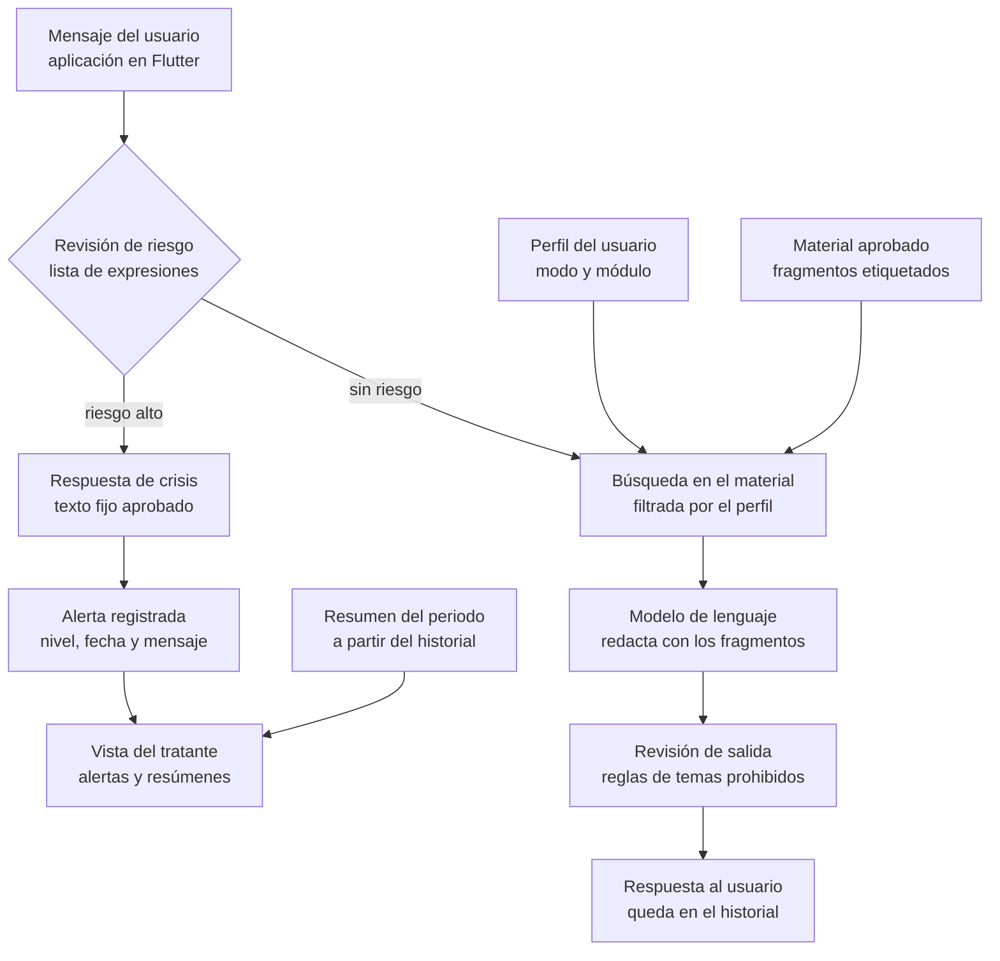

# Proyecto Holo: documento de trabajo para el equipo

12 de noviembre de 2026 · Maria Zapata

## 1. Presentación

El presente documento establece el marco de trabajo del proyecto Holo para los seis integrantes del equipo: define el problema que se aborda, los objetivos, el alcance de la primera entrega, la distribución de responsabilidades y el cronograma. Su propósito es que todo el equipo comparta una misma comprensión del proyecto antes de iniciar el desarrollo.

Holo es una aplicación móvil de apoyo conversacional en salud mental. Su componente central es un asistente conversacional (chatbot) que responde únicamente a partir de conocimiento psicológico validado por especialistas. El nombre del proyecto es provisional.

La primera entrega consiste en una demostración funcional, a desarrollarse en un plazo de dos semanas, cuyo fin es presentar formalmente la idea. No constituye un producto destinado al uso con pacientes.

### 1.1 Justificación

El proyecto responde a tres necesidades identificadas:

- **Continuidad entre sesiones de terapia.** El paciente atraviesa el periodo entre una sesión y la siguiente sin acompañamiento, y el profesional tratante debe reconstruir lo ocurrido al inicio de cada encuentro.
- **Acceso a un espacio de apoyo.** Existen personas que no cuentan con un terapeuta, que experimentan estrés o soledad, o a quienes les resulta difícil conversar con otras personas.
- **Control sobre las respuestas de la inteligencia artificial.** Los asistentes conversacionales de propósito general pueden generar información incorrecta o inapropiada en un ámbito sensible; se requiere un asistente acotado y supervisable.

## 2. Objetivos

### 2.1 Objetivo general

Desarrollar una aplicación móvil con un asistente conversacional que brinde apoyo psicológico de primer nivel, fundamentado en conocimiento validado por especialistas, tanto a pacientes en tratamiento como a personas sin un profesional tratante.

### 2.2 Objetivos específicos

1. Implementar un asistente conversacional que responda exclusivamente a partir de material psicológico aprobado, mediante la técnica de generación aumentada por recuperación (RAG).
2. Adaptar el comportamiento del asistente al perfil de cada usuario, diferenciando entre pacientes con tratante y usuarios estándar.
3. Generar para el profesional tratante un resumen del periodo entre sesiones, con hechos específicos, patrones observados y alertas.
4. Detectar situaciones de riesgo y derivar al usuario hacia ayuda profesional y líneas públicas de atención.
5. Presentar una demostración funcional que evidencie los cuatro puntos anteriores en un plazo de dos semanas.

## 3. Descripción de la solución

Holo atiende a dos tipos de usuario mediante un mismo asistente, con reglas diferenciadas para cada uno.

| Usuario | Descripción | Función de Holo |
| --- | --- | --- |
| Paciente con tratante | Persona adulta diagnosticada y en terapia. El primer módulo especializado corresponde a ansiedad | Acompaña el periodo entre sesiones y entrega al tratante un resumen de lo ocurrido |
| Usuario estándar | Persona adulta sin tratante, que busca un espacio de apoyo | Ofrece conversación de apoyo y técnicas de relajación, con uso diario y sin límite de tiempo |
| Profesional tratante | Psicólogo o terapeuta del paciente. A largo plazo, profesionales reales registrados en el sistema | Recibe el resumen del periodo y las alertas de sus pacientes |

### 3.1 Principios de funcionamiento

- **Conocimiento acotado.** El asistente responde solo desde el material aprobado. Si el material no cubre una consulta, lo indica y orienta hacia un profesional.
- **Sin entrenamiento del modelo.** El comportamiento se controla mediante el material recuperado, las instrucciones del sistema y el perfil del usuario.
- **Privacidad de la conversación.** Por defecto, el tratante recibe el resumen y no la conversación. El paciente puede destacar información adicional y puede solicitar el envío de la conversación completa.
- **Derivación ante riesgo.** Ante una situación de riesgo, el asistente deja de sugerir técnicas y presenta un mensaje fijo con recursos de ayuda inmediata.

### 3.2 Límites de la solución

Holo no emite diagnósticos, no indica ni comenta medicación, no modifica planes de tratamiento y no sustituye al profesional tratante ni a un servicio de emergencia. El resumen para el tratante describe hechos y patrones; la interpretación clínica corresponde exclusivamente al profesional.

## 4. Alcance de la primera entrega

La primera entrega comprende cuatro pantallas y un servicio de backend, y opera con dos cuentas de demostración y datos ficticios.

### 4.1 Delimitación del alcance

| Se incluye | Se incluye solo si el tiempo lo permite | Se excluye de esta entrega |
| --- | --- | --- |
| Pantalla de consentimiento informado | Destacar un mensaje para el tratante | Registro de usuarios e inicio de sesión |
| Conversación con el asistente sobre 5 a 10 textos de ansiedad y estrés | Clasificación de riesgo mediante el modelo | Vinculación de paciente y tratante por código |
| Dos técnicas guiadas: respiración y anclaje al presente | Registro diario del estado de ánimo | Cuestionario inicial y nivel de sugerencia ajustable |
| Rechazo de consultas sobre diagnóstico y medicación | Publicación del backend en internet | Envío de la conversación completa al tratante |
| Detección de riesgo por lista de expresiones y pantalla fija de crisis |  | Notificaciones, voz y memoria entre sesiones |
| Generación del resumen de la semana |  | Red de psicólogos reales |
| Vista del tratante con la alerta y el resumen de un paciente |  | Pruebas con personas reales |

Las dos cuentas de demostración se entregan creadas: una usuaria estándar y un paciente vinculado a una tratante, con una semana de conversaciones ficticias.

### 4.2 Requerimientos funcionales de la entrega

La entrega cubre 14 de los 35 requerimientos funcionales del sistema. La numeración corresponde a la especificación de requerimientos completa.

| ID | Requerimiento | Criterio de aceptación |
| --- | --- | --- |
| RF-02 | Consentimiento informado y declaración de mayoría de edad antes del primer uso | Sin la aceptación no se accede a la conversación; se registra la fecha |
| RF-03 | Modo de uso: paciente con tratante o usuario estándar | El modo de la cuenta determina el material que el asistente puede emplear |
| RF-07 | Conversación de texto con historial | Al reabrir la aplicación se muestran los mensajes anteriores |
| RF-08 | Respuestas fundamentadas en el material aprobado | Cada respuesta registra al menos un fragmento empleado; sin fragmento pertinente, el asistente indica que no puede ayudar con esa consulta |
| RF-09 | Rechazo de consultas sobre diagnóstico, medicación y cambios de tratamiento | Se rechazan todos los casos del conjunto de prueba |
| RF-10 | Técnicas guiadas de relajación | Se dispone de dos técnicas completas, guiadas paso a paso |
| RF-11 | Módulo de ansiedad | Su material solo se emplea con cuentas en modo paciente |
| RF-19 | Resumen del periodo con hechos específicos, temas, patrones y alertas | Cada hecho indica el día de la conversación de origen; no contiene diagnósticos ni recomendaciones clínicas |
| RF-23 | Revisión de riesgo de cada mensaje antes de responder | Se identifican como riesgo alto todos los mensajes de riesgo del conjunto de prueba |
| RF-24 | Respuesta fija de crisis | Se muestra el texto fijo con ECU 911 y línea 171, opción 6, y el asistente no propone técnicas |
| RF-25 | Registro de la alerta | La alerta muestra fecha, nivel y mensaje de origen al tratante vinculado |
| RF-30 | Vista del tratante | El tratante visualiza la alerta y el resumen de su paciente |
| RF-33 | Carga del material con etiquetas de tema, modo y módulo | Un documento cargado se recupera en una búsqueda de su tema |
| RF-35 | Auditoría de respuestas | Por cada respuesta se conserva el resultado de la revisión de riesgo y los fragmentos empleados |

## 5. Arquitectura y tecnología

El sistema se compone de una aplicación en Flutter, un backend en FastAPI y un modelo de lenguaje externo. El backend ejecuta la misma secuencia de pasos para cada mensaje.

**Figura 1. Recorrido de un mensaje en el backend**

Cuando la revisión identifica riesgo alto, el mensaje no llega al modelo: se muestra la respuesta fija y se registra la alerta. En los demás casos, el perfil del usuario delimita el material que se consulta, el modelo redacta a partir de los fragmentos recuperados y una revisión final descarta los contenidos no permitidos.

### 5.1 Tecnologías seleccionadas

La totalidad del sistema se construye con herramientas gratuitas o de código abierto.

| Capa | Tecnología | Observación |
| --- | --- | --- |
| Aplicación | Flutter, con Android como primera plataforma | Paciente y tratante emplean la misma aplicación; el rol determina las pantallas |
| Backend | FastAPI (Python) | Se emplea únicamente FastAPI; no se requiere Flask |
| Base de datos | SQLite | No requiere servidor ni cuentas; en versiones posteriores se migra a PostgreSQL |
| Búsqueda semántica | ChromaDB en modo local | En versiones posteriores, pgvector sobre PostgreSQL |
| Vectorización del texto | Modelo multilingüe de código abierto, ejecutado en el backend | El material no se envía a terceros |
| Modelo de lenguaje | Proveedor con nivel gratuito ([Gemini API](https://benchlm.ai/free-tier/google-ai-studio) o [Groq](https://benchlm.ai/free-tier/groq)), encapsulado en una interfaz propia | Los límites gratuitos varían; deben verificarse el primer día. Solo se envían datos ficticios |

### 5.2 Interfaz entre la aplicación y el backend

La aplicación se comunica exclusivamente con el backend mediante una API REST; nunca invoca directamente al modelo de lenguaje.

| Ruta | Función |
| --- | --- |
| `POST /consentimiento` | Registra la aceptación del usuario |
| `POST /chat` | Recibe un mensaje, revisa el riesgo y devuelve la respuesta o el texto de crisis |
| `GET /chat/historial` | Devuelve los mensajes anteriores del usuario |
| `POST /resumen` | Genera el resumen de los últimos siete días de un paciente |
| `GET /tratante/paciente` | Devuelve el último resumen y las alertas del paciente vinculado |

## 6. Organización del equipo y cronograma

El equipo está conformado actualmente por seis integrantes, y cada uno asume un rol con un entregable verificable. La asignación nominal se definirá en la primera reunión.

### 6.1 Roles y responsabilidades

| Rol | Responsabilidades | Entregable | Integrante |
| --- | --- | --- | --- |
| 1 · Coordinación y presentación | Enlace con la especialista, recopilación del material, presentación formal y guion de la demostración | Material etiquetado, diapositivas y guion | Por asignar |
| 2 · Aplicación: conversación | Pantalla de consentimiento y pantalla de conversación en Flutter | Conversación operativa desde el teléfono | Por asignar |
| 3 · Aplicación: crisis y tratante | Pantalla de crisis y vista del tratante en Flutter | Visualización de la alerta y del resumen | Por asignar |
| 4 · Backend | FastAPI, SQLite, rutas de la API y cuentas de demostración | API operativa en la red local | Por asignar |
| 5 · Inteligencia artificial: conocimiento | Carga del material, búsqueda semántica e instrucciones del asistente | Respuestas fundamentadas en el material | Por asignar |
| 6 · Inteligencia artificial: riesgo y resumen | Lista de expresiones de riesgo, generación del resumen y conjunto de pruebas | Alertas, resumen y pruebas ejecutadas | Por asignar |

Dado que el equipo no cuenta con especialistas en todas las áreas, se recomienda que los roles 2 y 3, por una parte, y los roles 5 y 6, por otra, trabajen en pareja y se apoyen mutuamente.

### 6.2 Cronograma de diez días hábiles

| Días | Fase | Resultado esperado al cierre |
| --- | --- | --- |
| 1 y 2 | Preparación | Entornos instalados, clave gratuita del modelo verificada, pantalla de conversación que recibe una respuesta de prueba del backend y textos provisionales recopilados |
| 3 a 5 | Conversación completa | Mensaje enviado desde Flutter que pasa por FastAPI, consulta el material y obtiene respuesta; consentimiento y rechazos operativos |
| 6 y 7 | Riesgo y resumen | Lista de expresiones, pantalla de crisis, alerta registrada y resumen generado desde el backend |
| 8 | Vista del tratante | Vista conectada al backend y datos de demostración cargados |
| 9 | Pruebas | Conjunto de mensajes de prueba ejecutado y errores corregidos |
| 10 | Presentación | Demostración ensayada dos veces y grabación de respaldo disponible |

Se sugiere una reunión breve de seguimiento al cierre de cada fase, a fin de verificar el resultado esperado antes de iniciar la siguiente.

## 7. Criterios de aceptación y demostración

La entrega se considera lista cuando se cumplen los cinco criterios siguientes.

- [ ] El guion de la demostración se ejecuta completo dos veces consecutivas sin intervención del equipo
- [ ] Todos los mensajes de riesgo del conjunto de prueba activan la pantalla de crisis
- [ ] Todas las consultas sobre diagnóstico y medicación del conjunto de prueba son rechazadas
- [ ] El resumen del paciente de demostración no contiene diagnósticos ni recomendaciones clínicas
- [ ] La presentación declara de forma explícita que el material es provisional y que los datos son ficticios

### 7.1 Guion de la demostración

1. Ana, usuaria estándar, acepta el consentimiento y manifiesta que se encuentra estresada. El asistente la escucha y la guía en un ejercicio de respiración.
2. Ana consulta si debería tomar algún medicamento para dormir. El asistente indica que no opina sobre medicación y la orienta hacia un profesional.
3. Luis, paciente con ansiedad, escribe un mensaje de riesgo. Se presenta la pantalla fija de crisis con ECU 911 y la línea 171.
4. La tratante abre su vista y observa la alerta de Luis y el resumen de su semana, con hechos fechados.

## 8. Consideraciones éticas y legales

El proyecto trata información de salud mental, por lo que todo el equipo debe observar las siguientes condiciones durante el desarrollo.

- **Datos ficticios.** En esta entrega no se emplean datos de personas reales. Los proveedores gratuitos de modelos pueden utilizar el contenido recibido para mejorar sus productos.
- **Material provisional.** Mientras la especialista no valide el contenido, este se identifica como provisional y no se presenta como orientación clínica.
- **Sin uso con pacientes.** Cualquier prueba con personas reales requiere aprobación formal, supervisión profesional y la revisión ética correspondiente.
- **Mayoría de edad.** El sistema se dirige exclusivamente a personas mayores de 18 años.
- **Protección de datos.** La Ley Orgánica de Protección de Datos Personales del Ecuador considera los datos de salud como categoría especial ([NMS Law](https://nmslaw.com.ec/?p=11818)). Una versión destinada a usuarios reales requiere revisión jurídica previa.
- **Recursos de ayuda.** El mensaje de crisis remite al ECU 911 y a la línea 171, opción 6, del Ministerio de Salud Pública ([MSP](https://www.salud.gob.ec/a-traves-de-la-linea-171-msp-ofrece-atencion-en-salud-mental/)). El horario vigente de la línea debe confirmarse antes de la presentación.
- **Claves de acceso.** Las claves de los proveedores se almacenan únicamente en el backend y no se publican en el repositorio.

## 9. Aspectos pendientes

Los siguientes puntos permanecen abiertos; los tres primeros dependen de la reunión con la especialista.

- [ ] Material de la especialista: contenido, formato y fecha de entrega
- [ ] Expresiones de riesgo y texto de crisis: redacción y aprobación
- [ ] Protocolo de actuación del tratante ante una alerta
- [ ] Asignación nominal de los seis roles
- [ ] Proveedor gratuito del modelo de lenguaje a emplear
- [ ] Aprobación para una eventual prueba con personas reales
- [ ] Nombre definitivo del producto

## Referencias

- [Holo: especificación de requerimientos de software](https://claude.ai/artifact/6aDabG6JT7j7Z2j5Fn4N4y). Documento interno con los 35 requerimientos funcionales, las reglas de negocio y los requerimientos no funcionales.
- Ministerio de Salud Pública del Ecuador. [A través de la línea 171 MSP ofrece atención en salud mental](https://www.salud.gob.ec/a-traves-de-la-linea-171-msp-ofrece-atencion-en-salud-mental/).
- NMS Law. [Entra en vigencia la Ley Orgánica de Protección de Datos Personales](https://nmslaw.com.ec/?p=11818).
- BenchLM. [Google AI Studio free tier](https://benchlm.ai/free-tier/google-ai-studio). Consultado el 12 de noviembre de 2026.
- BenchLM. [Groq free tier](https://benchlm.ai/free-tier/groq). Consultado el 12 de noviembre de 2026.
